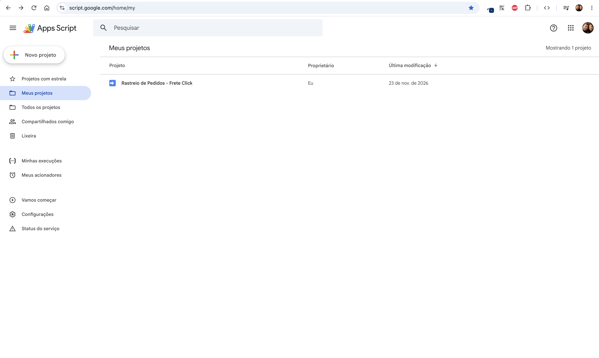
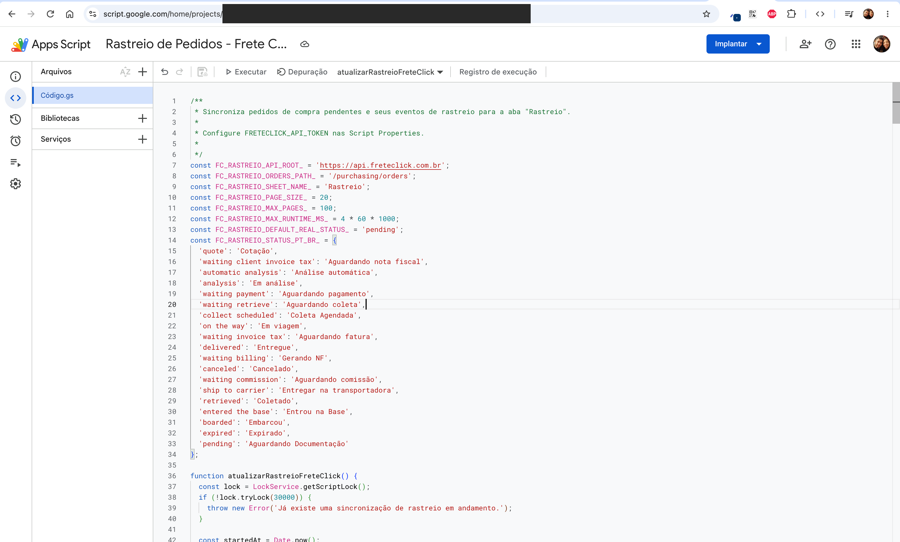
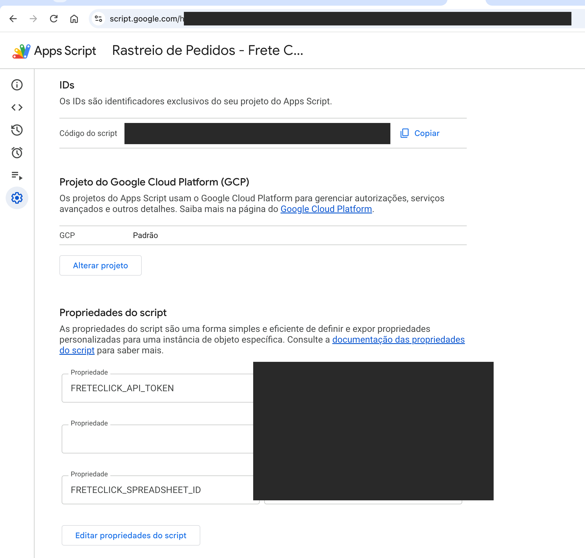
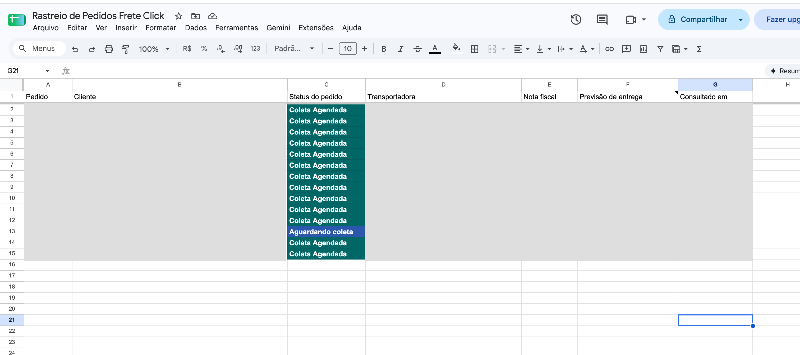
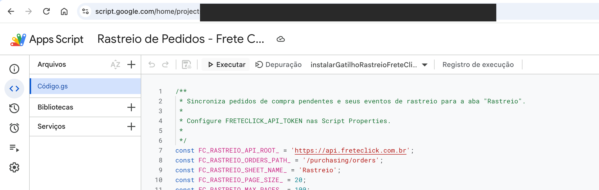
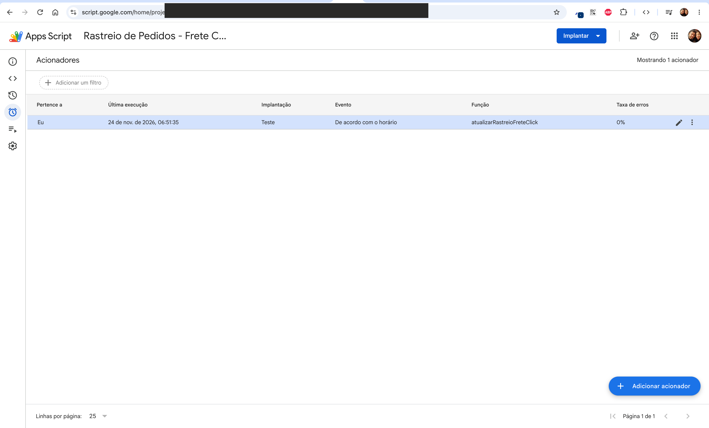

# Guia de configuração do rastreio Frete Click no Google Apps Script

Este guia explica como criar o projeto no Google Apps Script, instalar o código,
configurar a chave de API e ativar a atualização automática da planilha.

O projeto consulta os pedidos pendentes das empresas vinculadas à chave Frete
Click e atualiza uma planilha Google com o resultado.

> **Importante:** não é necessário criar uma implantação pelo botão
> **Implantar**. A automação é executada por um acionador de tempo do Apps
> Script.

## O que você precisa

- Uma conta Google.
- Uma chave de API Frete Click válida para o cliente.
- O arquivo [`RastreioFreteClick.gs`](../RastreioFreteClick.gs).
- Acesso à página [Meus projetos do Apps Script](https://script.google.com/home/my).

## 1. Criar o projeto

1. Acesse [script.google.com/home/my](https://script.google.com/home/my).
2. Clique em **Novo projeto**.
3. Clique no título do projeto, no alto da tela, e renomeie para
   **Rastreio de Pedidos - Frete Click**.

## 2. Adicionar o código

1. Abra o arquivo [`RastreioFreteClick.gs`](../RastreioFreteClick.gs) deste
   repositório.
2. Copie todo o conteúdo do arquivo.
3. No editor do Apps Script, abra o arquivo padrão `Código.gs` (ou `Code.gs`).
4. Apague o conteúdo de exemplo e cole o código copiado.
5. Salve o projeto pelo ícone de salvar ou com **⌘S** no Mac
   (**Ctrl+S** no Windows).

Use o conteúdo completo do arquivo. Não cole as crases de um bloco de código e
não coloque a chave de API dentro do código.

## 3. Configurar as propriedades do script

A chave deve ficar nas propriedades do projeto, não no código:

1. No menu lateral do Apps Script, abra **Configurações do projeto**
   (ícone de engrenagem).
2. Localize **Propriedades do script**.
3. Clique em **Adicionar propriedade do script**.
4. Cadastre a propriedade obrigatória abaixo e salve:

| Propriedade | Valor | Obrigatória? | Finalidade |
| --- | --- | --- | --- |
| `FRETECLICK_API_TOKEN` | Chave de API do cliente | Sim | Autentica as chamadas à API Frete Click. |
| `FRETECLICK_REAL_STATUS` | `pending` | Não | Status consultado. Se omitido, o script usa `pending`. |
| `FRETECLICK_SPREADSHEET_ID` | ID de uma planilha existente | Não | Direciona o relatório para uma planilha existente. |

Para o primeiro uso, basta cadastrar `FRETECLICK_API_TOKEN`. Deixe as outras
propriedades sem cadastro para usar os valores padrão.

O ID de uma planilha existente é o trecho entre `/d/` e `/edit` no endereço da
planilha. Se `FRETECLICK_SPREADSHEET_ID` não for informado, o projeto
independente criará uma planilha automaticamente na primeira execução e
guardará o ID para as próximas execuções.

> **Segurança:** não compartilhe capturas de tela que mostrem o valor da chave.
> Se precisar registrar esta etapa, oculte completamente o campo **Valor**.

## 4. Executar a primeira sincronização e autorizar o acesso

1. Volte ao editor e salve o projeto.
2. No seletor de funções, escolha `atualizarRastreioFreteClick`.
3. Clique em **Executar**.
4. Na primeira execução, o Google solicitará autorização. Escolha a conta
   correta, revise as permissões e permita o acesso solicitado pelo script.
5. Aguarde o término da execução e confira **Registro de execução** ou a página
   **Execuções**.

O script precisa consultar a API externa e escrever em uma planilha. Se não
existir uma planilha configurada, será criada uma chamada
**Rastreio de Pedidos Frete Click**, com uma aba chamada **Rastreio**. O link da
planilha criada aparece no registro da execução; ela também pode ser localizada
no Google Drive pelo nome.

### Colunas do relatório

A aba **Rastreio** contém:

1. Pedido
2. Cliente
3. Status do pedido
4. Transportadora
5. Nota fiscal
6. Previsão de entrega
7. Consultado em

O status é traduzido para português e colorido conforme a informação recebida
da API. A previsão é apresentada como um intervalo de datas quando há uma data
disponível. A orientação **“A previsão será atualizada após a coleta.”** fica
como nota no cabeçalho da coluna de previsão. **Consultado em** mostra a data e
o horário da consulta no formato `dd/MM/yyyy HH:mm:ss`.

## 5. Ativar a atualização automática

Depois de confirmar que a execução manual funcionou:

1. No seletor de funções, escolha `instalarGatilhoRastreioFreteClick`.
2. Clique em **Executar** e autorize, caso o Google solicite.
3. No menu lateral, abra **Acionadores** (ícone de relógio).
4. Confirme que existe um acionador para
   `atualizarRastreioFreteClick`, do tipo **Baseado em tempo**, com frequência
   de **A cada 6 horas**.

A função de instalação substitui um acionador anterior dessa mesma rotina antes
de criar outro, evitando duplicidade. Os horários são aproximados e a execução
ocorre na conta Google que criou o acionador.

## 6. Sobre o botão “Implantar”

Não use **Implantar** para ativar esta automação. Esse menu é destinado a outros
tipos de publicação, como aplicativo da Web, executável da API ou complemento.
Para este relatório, o acionador de tempo é suficiente e não é necessária uma
implantação.

Se o código for atualizado no futuro, cole a versão nova no editor e salve. O
acionador existente continuará executando o código salvo; não é necessário
criar uma implantação.

## 7. Comportamento e verificações

- A atualização automática consulta os pedidos pendentes a cada seis horas.
- Cada sincronização bem-sucedida com pedidos substitui o relatório anterior
  pelos pedidos encontrados naquele momento.
- Se a API não retornar empresas ou pedidos, o conteúdo anterior é preservado
  para evitar apagar o relatório por engano. Confira os detalhes em
  **Execuções** e **Registro de execução**.
- Para executar uma atualização fora do horário automático, execute
  `atualizarRastreioFreteClick` manualmente.
- A formatação e as larguras das colunas são atualizadas pelo próprio script.

### Problemas comuns

| Situação | O que verificar |
| --- | --- |
| Erro informando que o token não está configurado | Confirme que `FRETECLICK_API_TOKEN` foi salvo nas **Propriedades do script**. |
| Nenhuma empresa foi encontrada | Verifique se a chave pertence ao cliente esperado e se tem empresas vinculadas. |
| Nenhum pedido pendente apareceu | Confira o status configurado e o registro da execução. Se não houver pedidos, a aba anterior não é apagada. |
| A automação não executou | Abra **Acionadores** e **Execuções** para verificar se o acionador existe e se houve erro. |
| O relatório está em outra planilha | Verifique `FRETECLICK_SPREADSHEET_ID` nas propriedades do projeto. |

As capturas incluídas ocultam os identificadores e dados operacionais. A lista
de acionadores confirma a rotina ativa; para mostrar visualmente o intervalo
exato de seis horas, abra a edição do acionador e capture a tela de configuração.
